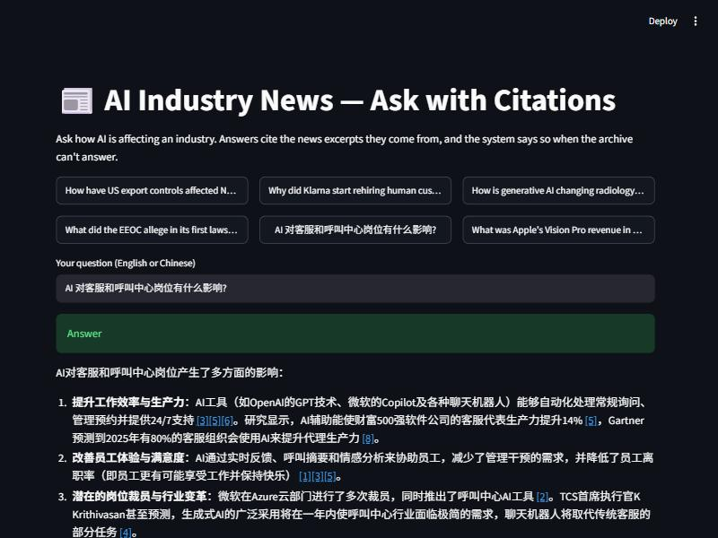
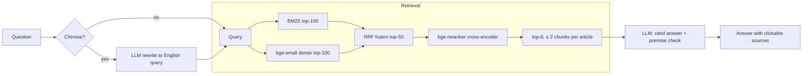

# AI Industry News RAG

Ask how AI is changing an industry and get an answer **with citations** from 33,234 news articles
(Jan 2022 – Feb 2026). When the archive can't answer, the system **says so** instead of guessing.

This project extends an NLP topic-modeling project, BERTopic over 135k AI news articles, into a
question-answering system. It is built and evaluated at **$0**: local GPU models plus a free-tier LLM.



## Highlights

| | |
|---|---|
| Corpus | 135,608 scraped articles → 33,234 after relevance filtering, sentence-level boilerplate removal and syndication dedup → 188,454 chunks |
| Retrieval | BM25 + bge-small dense vectors fused with RRF, then a bge cross-encoder reranker; date / industry / sentiment filters |
| Generation | Every sentence cites its excerpts `[n]`; a premise check makes it decline false-premise questions; Chinese questions are rewritten into English queries |
| Evaluation | 75-question test set (single-doc, multi-doc, unanswerable) built with automatic quality gates plus per-question review; retrieval ablations with paired-bootstrap CIs; LLM judge validated against a stronger judge (Cohen's κ) |

### Key results ([full report](eval/REPORT.md))

| | |
|---|---|
| Retrieval Hit@1 / Hit@10 (default config) | **0.80 / 0.98** |
| Reranker effect on Hit@1 | +6.8 pp over BM25, +10.2 pp over hybrid (consistent, not significant at n = 59) |
| Dense-only vs BM25 | **significantly worse**: Hit@10 −8.5 pp, 95% CI [−15.3, −1.7] |
| Correct abstention on unanswerable questions | 0.81 → **1.00** after adding the premise check, with 0 false abstentions |
| Local 7B judge vs Gemini judge | reliable for abstention (κ 0.87), lenient on correctness (κ 0.44), **unreliable for hallucination (κ 0.10)** |

Things that didn't work are reported too. Query decomposition left every metric unchanged at 2×
latency, so it isn't on by default (see the report for why).

## Architecture



## Quickstart

```bash
python -m venv .venv && .venv/Scripts/activate        # Windows; use bin/activate elsewhere
pip install torch --index-url https://download.pytorch.org/whl/cu128   # or the CPU wheel
pip install -r requirements.txt
cp .env.example .env                                   # add a free Gemini key, or use Ollama

# Build the corpus and indexes from the original project's parquet files in data/raw/
python scripts/build_corpus.py && python scripts/build_index.py

python scripts/ask.py "How did Klarna's AI push affect its support staff?"
streamlit run app/streamlit_app.py                     # web UI
uvicorn app.api:app --port 8000                        # REST API, docs at /docs
```

## Repository layout

```
src/rag/        clean.py · chunking.py · index.py · retriever.py · pipeline.py · llm.py · evaluation.py
scripts/        build_corpus / build_index / build_variant      data and indexes
                build_testset / filter_testset                 test-set generation + quality gates
                eval_retrieval / significance / eval_answers / validate_judge
app/            service.py (cache, daily budget, fallbacks) · api.py (FastAPI) · streamlit_app.py
eval/           REPORT.md · testset_review.csv (every review decision) · results/
```

## Design notes

- **Free-tier engineering.** All LLM calls go through a SQLite cache, so eval reruns are free and
  interrupted runs resume. Gemini runs through a fallback chain, since quotas are per model. The demo has a
  global daily budget and falls back to showing sources only when the LLM is unavailable.
- **Local models on an 8 GB laptop GPU.** `qwen2.5:7b` via Ollama for test generation and judging. Ollama
  0.40 on an RTX 5060 sometimes degenerated into "8888…" output, so the client detects it, reloads
  the model and retries.
- **Copyright.** The demo shows short snippets and links to the original articles, never full text.
  The index is hosted in a private dataset.

## Limitations

- The test set is LLM-generated (lexical overlap favors BM25) and was reviewed by an AI
  assistant, not independent human annotators. The multi-document split has only n = 9.
- The 7B answerer adds unsupported summarizing sentences (Gemini-judged faithfulness 0.70). The
  hosted demo uses Gemini.
- The corpus ends in Feb 2026, and the sources are whatever the original scrape collected.
